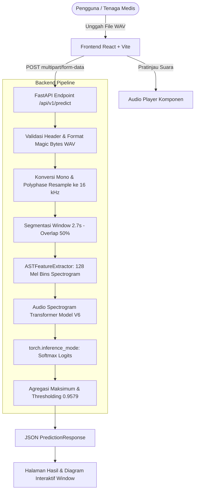

# TestYourBreath — AI-Assisted Respiratory Sound Screening Platform

> **"Setiap Tarikan Napas Berharga: Membuka Akses Skrining Respirasi Berkeadilan Melalui Kecerdasan Buatan."**

TestYourBreath (PulmoSense) adalah platform skrining awal berbasis kecerdasan buatan (*Artificial Intelligence*) yang menganalisis rekaman suara pernapasan (auskultasi paru) menggunakan arsitektur **Audio Spectrogram Transformer (AST)** yang di-*fine-tune* pada dataset **ICBHI 2017 Respiratory Sound Database**.

Aplikasi ini dibangun secara menyeluruh mencakup backend FastAPI berkinerja tinggi, pipeline pemrosesan sinyal audio digital, inferensi model deep learning murni tanpa mock data, visualisasi interaktif per-window, serta antarmuka web modern berbahasa Indonesia.

---

## 🌍 Latar Belakang & Masalah Sosial (The Problem)

Penyakit sistem pernapasan merupakan salah satu krisis kesehatan masyarakat terbesar di dunia dan Indonesia, namun kerap menjadi **"silent killer"** karena ketidaksetaraan akses fasilitas kesehatan:

1. **Beban Penyakit yang Mengancam Jiwa**:
   - Berdasarkan data **World Health Organization (WHO)**, Penyakit Paru Obstruktif Kronis (PPOK), Pneumonia, dan Asma merenggut lebih dari **4 juta jiwa setiap tahunnya**.
   - Di Indonesia, Infeksi Saluran Pernapasan Akut (ISPA) dan pneumonia konsisten menjadi salah satu penyebab mortalitas tertinggi, khususnya pada kelompok rentan seperti anak-anak balita dan lansia.
2. **Ketimpangan Fasilitas Kesehatan & Tenaga Spesialis (Healthcare Inequity)**:
   - Rasio dokter spesialis paru (pulmonolog) per kapita di Indonesia masih sangat minim dan terkonsentrasi di kota-kota besar.
   - Fasilitas pelayanan kesehatan primer (Puskesmas) dan daerah 3T (Tertinggal, Terdepan, Terluar) seringkali beroperasi tanpa alat penunjang diagnostik respirasi digital yang memadai, sehingga skrining bergantung penuh pada pendengaran manual.
3. **Subjektivitas Auskultasi Konvensional & "Late Diagnosis Penalty"**:
   - Auskultasi menggunakan stetoskop akustik konvensional rentan bias subjektif pemeriksa dan kebisingan lingkungan sekitar.
   - Akibatnya, anomali akustik awal seperti *crackles* (ronki basah) atau *wheezes* (mengi) kerap terlewat hingga penyakit berkembang ke stadium lanjut. Keterlambatan ini berujung pada biaya pengobatan katastropik bagi keluarga kurang mampu serta risiko fatalitas yang jauh lebih tinggi.

---

## 🎯 Tujuan & Visi Proyek (Our Mission)

**TestYourBreath** dikembangkan dengan satu misi fundamental: **Mendemokratisasi akses skrining kesehatan pernapasan agar dapat dijangkau oleh seluruh lapisan masyarakat secara adil, cepat, dan non-invasif.**

- **Demokratisasi Skrining Awal Cepat & Terjangkau**: Memberikan akses kepada masyarakat luas untuk melakukan skrining mandiri hanya dengan mengunggah rekaman audio pernapasan, menghasilkan analisis instan (<2 detik) tanpa perlu perangkat keras medis berbiaya mahal.
- **Dukungan Triase untuk Nakes Primer**: Menjadi instrumen *second opinion* yang objektif bagi dokter umum, perawat, atau kader posyandu di daerah terpencil untuk menentukan urgensi rujukan pasien ke fasilitas rujukan lanjutan secara lebih terukur.
- **Transparansi Berbasis Segmen (Explainable AI)**: Mengatasi kelemahan AI "kotak hitam" (*black box*) dengan membedah sinyal pernapasan ke dalam visualisasi window 2,7 detik, membantu pengguna dan tenaga medis memahami segmen mana yang memicu indikasi abnormalitas.

---

## 💡 Dampak Sosial & Relevansi SDG (Social Impact)

Proyek ini tidak hanya berfokus pada kecanggihan komputasi, melainkan dirancang dengan sentuhan kemanusiaan untuk menjawab target pembangunan global:

| Target SDG | Kontribusi & Dampak Nyata TestYourBreath |
| :--- | :--- |
| **SDG 3: Good Health & Well-being** *(Kesehatan yang Baik dan Kesejahteraan)* | Membantu menurunkan angka kematian dini akibat penyakit paru kronis dan infeksi respirasi melalui intervensi deteksi dini pada masa *golden period*. |
| **SDG 10: Reduced Inequalities** *(Berkurangnya Kesenjangan)* | Menjembatani jurang fasilitas antara wilayah rural/3T dan urban dengan menghadirkan kapabilitas skrining berbasis AI kelas rumah sakit rujukan ke genggaman masyarakat. |
| **Efisiensi Beban Finansial Keluarga & JKN** | Mencegah lonjakan beban biaya pengobatan stadium lanjut (seperti perawatan ventilator di ICU) dengan mendorong penanganan preventif sejak dini, meringankan beban ekonomi keluarga dan sistem BPJS. |
| **Prinsip AI yang Bertanggung Jawab (Responsible AI)** | Menjunjung privasi mutlak pasien (rekaman audio segera dihapus dari memori, *zero data retention*), mengedukasi masyarakat tanpa memicu kepanikan, serta memposisikan AI sebagai mitra kolaboratif tenaga medis, bukan pengganti diagnosis dokter. |

---

## 📑 Daftar Isi

- [Latar Belakang & Masalah Sosial](#-latar-belakang--masalah-sosial-the-problem)
- [Tujuan & Visi Proyek](#-tujuan--visi-proyek-our-mission)
- [Dampak Sosial & Relevansi SDG](#-dampak-sosial--relevansi-sdg-social-impact)
- [Fitur Utama](#-fitur-utama)
- [Arsitektur Sistem](#-arsitektur-sistem)
- [Struktur Proyek](#-struktur-proyek)
- [Persyaratan Sistem](#-persyaratan-sistem)
- [Spesifikasi Model & Preprocessing](#-spesifikasi-model--preprocessing)
- [Panduan Instalasi & Menjalankan Aplikasi](#-panduan-instalasi--menjalankan-aplikasi)
  - [🐳 Opsi A: Docker & Docker Compose (Paling Cepat & Direkomendasikan)](#-opsi-a-docker--docker-compose-paling-cepat--direkomendasikan)
  - [💻 Opsi B: Instalasi Manual Lokal (Development)](#-opsi-b-instalasi-manual-lokal-development)
    - [1. Backend (FastAPI + PyTorch)](#1-backend-fastapi--pytorch)
    - [2. Frontend (React + Vite + Tailwind CSS)](#2-frontend-react--vite--tailwind-css)
- [Menjalankan Pengujian (Testing)](#-menjalankan-pengujian-testing)
- [Troubleshooting](#-troubleshooting)
- [Batasan Model & Etika AI](#-batasan-model--etika-ai)
- [Pernyataan Batasan Medis (Medical Disclaimer)](#-pernyataan-batasan-medis-medical-disclaimer)

---

## 🌟 Fitur Utama

1. **Inferensi Model Nyata (No Mock / No Dummy)**:
   - Menggunakan bobot checkpoint fine-tuning AST V6 (`pulmosense_v6_ast_window_final.pth`) dengan 86,2 juta parameter yang dimuat dengan verifikasi parameter ketat (`strict=True`).
2. **Pipeline Preprocessing Audio Digital Multi-Format**:
   - Mendukung format audio **WAV**, **MP3**, dan **M4A (AAC)** menggunakan integrasi `SoundFile` dan `PyAV` (FFmpeg decoder).
   - Konversi multi-channel (stereo) ke mono otomatis.
   - Resampling polyphase akurat ke sample rate model 16.000 Hz.
   - Validasi integritas sinyal (penolakan audio rusak, NaN, Infinity, dan keheningan mutlak).
3. **Segmentasi Window 2,7 Detik**:
   - Membagi audio ke dalam window 2,7 detik (43.200 sampel) dengan overlap 50% (stride 1,35 detik = 21.600 sampel) sesuai metodologi pelatihan model V6.
   - Penanganan audio pendek (< 2,7 detik) dengan right zero-padding yang konsisten.
4. **Agregasi Rekaman Maksimum (Maximum Aggregation)**:
   - Mengevaluasi skor abnormalitas per-window dan mengambil skor tertinggi sebagai skor representatif rekaman.
   - Klasifikasi Normal vs Abnormal berdasarkan ambang batas (*threshold*) aktual checkpoint (`0.9579`).
5. **Visualisasi Interaktif Antar-Window**:
   - Timeline diagram batang interaktif untuk setiap segmen window (W1, W2, ...).
   - Pengguna dapat mengeklik segmen untuk memeriksa waktu mulai, waktu selesai, skor abnormal, dan status ambang batas.
6. **Pratinjau Pemutar Audio (Audio Player)**:
   - Pemutar audio terintegrasi dengan gelombang playback, scrub bar, dan pelacak durasi.
   - Dilengkapi fitur pengujian cepat dengan generator contoh audio pernapasan sintetis (WAV).
7. **Pemeriksaan Kesehatan & Kesiapan Runtime**:
   - Endpoint `/api/v1/health` dan `/api/v1/model-info` yang memantau kesiapan model, alokasi memori, dan device eksekusi (CPU/CUDA).
8. **Keamanan & Privasi**:
   - Tidak menyimpan rekaman audio pengguna secara permanen. File dibersihkan dari memori segera setelah inferensi selesai.

---

## 🏛️ Arsitektur Sistem



---

## 📁 Struktur Proyek

```text
TestYourBreath/
├── docker-compose.yml                  # Orkestrasi multi-kontainer Docker (Backend & Frontend)
├── .dockerignore                       # Pengecualian berkas saat build Docker di root
│
├── frontend/
│   ├── Dockerfile                      # Multi-stage build Nginx Alpine untuk frontend React SPA
│   ├── nginx.conf                      # Konfigurasi reverse proxy & SPA routing Nginx
│   ├── .dockerignore                   # Pengecualian berkas konteks Docker frontend
│   ├── src/
│   │   ├── components/
│   │   │   ├── Navbar.jsx              # Navigasi & status indikator AST aktif
│   │   │   ├── Footer.jsx              # Footer, spesifikasi, dan disclaimer
│   │   │   ├── AudioUploader.jsx       # Drag & drop upload & generator audio demo
│   │   │   ├── AudioPlayer.jsx         # Custom audio player dengan visual bar
│   │   │   ├── AudioVisualizer.jsx     # Visualisasi spektrum gelombang pernapasan
│   │   │   ├── AnalysisProgress.jsx    # Status tahapan pemrosesan inferensi
│   │   │   ├── ResultSummary.jsx       # Ringkasan hasil klasifikasi & gauge threshold
│   │   │   ├── WindowResults.jsx       # Visualisasi timeline & tabel interaktif per-window
│   │   │   ├── RecordingGuide.jsx      # Panduan visual posisi auskultasi trakea leher depan
│   │   │   └── MedicalDisclaimer.jsx   # Banner batasan tanggung jawab medis
│   │   ├── pages/
│   │   │   ├── Home.jsx                # Beranda, penjelasan AST & manfaat
│   │   │   ├── Analyze.jsx             # Halaman skrining audio
│   │   │   ├── Results.jsx             # Halaman laporan hasil inferensi
│   │   │   └── About.jsx               # Dokumentasi model & batasan klinis
│   │   ├── services/
│   │   │   └── api.js                  # Klien API terpusat (fetch API backend)
│   │   ├── App.jsx                     # Router & manajemen state aplikasi
│   │   ├── main.jsx                    # Entry point React
│   │   └── index.css                   # Tailwind CSS v4 & konfigurasi font
│   ├── index.html                      # HTML root dengan Plus Jakarta Sans
│   ├── vite.config.js                  # Konfigurasi Vite & Tailwind v4
│   ├── package.json                    # Dependensi frontend
│   └── .env.example                    # Template variabel environment frontend
│
├── backend/
│   ├── Dockerfile                      # Kontainer Python 3.11-slim + libsndfile & ffmpeg
│   ├── .dockerignore                   # Pengecualian berkas konteks Docker backend
│   ├── app/
│   │   ├── main.py                     # Entry point FastAPI, CORS, & lifespan loader
│   │   ├── api/
│   │   │   ├── health.py               # Endpoint /health & /model-info
│   │   │   └── predict.py              # Endpoint inferensi suara /predict
│   │   ├── core/
│   │   │   └── config.py               # Konfigurasi sistem & path absolut model
│   │   ├── services/
│   │   │   ├── model_loader.py         # Pemuat model AST & verifikasi bobot ketat
│   │   │   ├── audio_processor.py      # Resampling 16kHz, mono, Butterworth, & windowing 2,7s
│   │   │   ├── inference_service.py    # Ekstraksi fitur mel & forward pass AST
│   │   │   └── result_aggregator.py    # Agregasi Mode Konsensus Robust & evaluasi threshold
│   │   ├── schemas/
│   │   │   └── prediction.py           # Skema Pydantic respon & input
│   │   └── utils/
│   │       └── file_validation.py      # Validasi ukuran & magic bytes RIFF/WAVE/MP3/M4A
│   ├── models/
│   │   └── ast/
│   │       ├── pulmosense_v6_ast_window_final.pth  # Checkpoint bobot AST fine-tuned (~345 MB)
│   │       ├── config.json                         # Konfigurasi arsitektur model
│   │       ├── preprocessor_config.json            # Konfigurasi ASTFeatureExtractor
│   │       └── model_metadata.json                 # Metadata threshold & windowing
│   ├── tests/
│   │   ├── conftest.py                 # Fixture pytest untuk inisialisasi model
│   │   ├── test_model_loader.py        # Pengujian pemuatan bobot strict=True
│   │   ├── test_audio_processor.py     # Pengujian resampling, filter CORSA, & windowing
│   │   ├── test_health.py              # Pengujian endpoint health & model-info
│   │   └── test_prediction.py          # Pengujian inferensi WAV nyata & error handling
│   ├── requirements.txt                # Dependensi Python
│   └── .env.example                    # Template variabel environment backend
│
├── .gitignore                          # Pencegahan commit file bobot besar & audio
└── README.md                           # Dokumentasi komprehensif proyek
```

---

## 💻 Persyaratan Sistem

- **Opsi Docker (Direkomendasikan)**:
  - **Docker Desktop** (Windows 10/11 atau macOS) atau **Docker Engine + Docker Compose v2** (Linux)
  - RAM yang dialokasikan ke Docker: Minimal 4 GB (Direkomendasikan 6–8 GB)
- **Opsi Manual Lokal**:
  - **Sistem Operasi**: Windows 10/11, macOS, atau Linux
  - **Python**: Versi **3.10** hingga **3.13** (Direkomendasikan Python 3.11 / 3.12 / 3.13)
  - **Node.js**: Versi **18+** atau **20+** (Teruji pada Node v24.12.0)
  - **RAM**: Minimal 4 GB (Direkomendasikan 8 GB untuk inferensi AST mulus pada CPU)
- **Penyimpanan**: Ruang kosong minimal ~1.5 GB untuk dependensi dan checkpoint bobot model AST

---

## 🔬 Spesifikasi Model & Preprocessing

| Parameter | Nilai / Keterangan |
| :--- | :--- |
| **Arsitektur Dasar** | Audio Spectrogram Transformer (`ASTForAudioClassification`) |
| **Checkpoint Basis** | `MIT/ast-finetuned-audioset-10-10-0.4593` |
| **Fine-Tuning Checkpoint** | `pulmosense_v6_ast_window_final.pth` |
| **Jumlah Parameter** | 86.190.338 parameter |
| **Target Kelas** | `["Normal", "Abnormal"]` |
| **Sampling Rate Target** | 16.000 Hz |
| **Panjang Window** | 2,7 detik (43.200 sampel) |
| **Overlap Window** | 50% (Stride 1,35 detik = 21.600 sampel) |
| **Resolusi Spektrogram** | 128 Mel Bins, frekuensi stride 10, waktu stride 10 |
| **Metode Agregasi Rekaman** | **Maximum Window Score** |
| **Ambang Batas (Threshold)** | **0.957912266254425** |

---

## 🚀 Panduan Instalasi & Menjalankan Aplikasi

> **Catatan Git LFS (Penting):** Proyek ini menggunakan Git LFS untuk mengelola file bobot model deep learning (`.pth`, ~345 MB). Pastikan Git LFS aktif saat meng-clone repository agar model terunduh penuh:
> ```powershell
> git lfs install
> git clone <URL-REPOSITORY-ANDA>
> # Atau jika file .pth belum terunduh: git lfs pull
> ```

---

### 🐳 Opsi A: Docker & Docker Compose (Paling Cepat & Direkomendasikan)

Metode ini menjalankan seluruh ekosistem **TestYourBreath** (Backend FastAPI + PyTorch dan Frontend Nginx Production) dalam kontainer terisolasi dengan satu perintah, tanpa perlu memasang Python atau Node.js di komputer host.

#### 1. Prasyarat
- Pastikan **Docker** dan **Docker Compose** telah terpasang dan aplikasi **Docker Desktop** sedang berjalan.

#### 2. Menjalankan Seluruh Sistem (One-Command Build & Run)
Buka terminal di direktori root proyek `TestYourBreath`:

```bash
# Build dan jalankan kedua kontainer (Backend & Frontend)
docker compose up --build
```

> **Ingin menjalankan di latar belakang (*detached mode*)?**
> ```bash
> docker compose up -d --build
> ```

#### 3. Akses Aplikasi & Layanan
Setelah kontainer berhasil berjalan:
- 🌐 **Antarmuka Pengguna (Frontend Web)**:
  - Buka peramban di: **`http://localhost:3000`** atau **`http://localhost:5173`**
- 🔌 **API Backend (FastAPI)**:
  - Dokumentasi Interaktif Swagger UI: **`http://localhost:8000/docs`**
  - Pemeriksaan Kesehatan Server & Model: **`http://localhost:8000/api/v1/health`**
  - Metadata Model AST: **`http://localhost:8000/api/v1/model-info`**

#### 4. Menghentikan Kontainer
Untuk menghentikan layanan Docker Compose:
```bash
docker compose down
```

#### 5. Perintah Berguna Lainnya (Docker CLI)
```bash
# Melihat log aktivitas kontainer secara real-time
docker compose logs -f

# Memeriksa status kesehatan kontainer
docker compose ps

# Menjalankan pengujian (pytest) di dalam kontainer backend yang sedang berjalan
docker compose exec backend pytest tests -v

# Membangun kontainer secara terpisah (opsional tanpa docker-compose):
# 1. Backend:
docker build -t testyourbreath-backend ./backend
docker run -d -p 8000:8000 --name testyourbreath-backend testyourbreath-backend

# 2. Frontend:
docker build -t testyourbreath-frontend ./frontend
docker run -d -p 3000:80 --name testyourbreath-frontend testyourbreath-frontend
```

---

### 💻 Opsi B: Instalasi Manual Lokal (Development)

Jika Anda ingin memodifikasi kode sumber secara aktif (*hot-reload development*), jalankan backend dan frontend di terminal terpisah:

#### 1. Backend (FastAPI + PyTorch)

Buka terminal pertama di direktori root `TestYourBreath`:

```powershell
# Masuk ke direktori backend
cd backend

# Buat virtual environment Python (opsional namun sangat disarankan)
python -m venv .venv

# Aktifkan virtual environment di Windows PowerShell
.\.venv\Scripts\Activate.ps1

# Jika terjadi restriction script execution di PowerShell, jalankan:
# Set-ExecutionPolicy -ExecutionPolicy RemoteSigned -Scope Process

# Pasang dependensi yang sesuai
pip install -r requirements.txt

# Jalankan server backend FastAPI dengan Uvicorn
uvicorn app.main:app --reload --host 127.0.0.1 --port 8000
```

> Backend akan berjalan di `http://127.0.0.1:8000`. Dokumentasi interaktif Swagger API tersedia di `http://127.0.0.1:8000/docs`.

---

#### 2. Frontend (React + Vite + Tailwind CSS)

Buka terminal kedua di direktori root `TestYourBreath`:

```powershell
# Masuk ke direktori frontend
cd frontend

# Pasang dependensi Node.js
npm install

# Jalankan server development Vite
npm run dev
```

> Buka peramban (*browser*) Anda pada tautan: **`http://127.0.0.1:5173/`**.

---

## 🧪 Menjalankan Pengujian (Testing)

Test suite backend memverifikasi seluruh komponen utama (model loader, audio preprocessing, endpoint API, dan pipeline inferensi):

```powershell
cd backend
python -m pytest tests -v
```

Hasil pengujian otomatis memvalidasi 12 skenario pengujian:
- `test_convert_to_mono`: Konversi audio multi-channel ke mono.
- `test_resample_audio`: Resampling polyphase ke 16 kHz.
- `test_slice_into_windows_standard`: Segmentasi window 2,7s dengan overlap 50%.
- `test_slice_into_windows_short_audio_padding`: Right zero-padding untuk audio pendek.
- `test_validate_and_clean_audio_silence`: Penolakan audio hening (amplitudo nol).
- `test_validate_and_clean_audio_nan`: Penolakan nilai sinyal tidak valid (NaN / Inf).
- `test_health_endpoint`: Pemeriksaan status server dan kesiapan model.
- `test_model_info_endpoint`: Validasi metadata runtime model AST.
- `test_model_loading_and_weights`: Verifikasi pemuatan bobot checkpoint dengan `strict=True`.
- `test_predict_endpoint_valid_audio`: Inferensi ujung-ke-ujung menggunakan file WAV nyata.
- `test_predict_endpoint_invalid_file_type`: Penolakan format file non-WAV.
- `test_predict_endpoint_empty_file`: Penolakan file kosong (0 bytes).

---

## 🔧 Troubleshooting

1. **`RuntimeError: Error(s) in loading state_dict for ASTForAudioClassification`**:
   - Penyebab: Menggunakan `transformers >= 5.x` di mana Hugging Face mengubah penamaan layer AST dari `audio_spectrogram_transformer.encoder.layer.X` menjadi `audio_spectrogram_transformer.layers.X`.
   - Solusi: Pastikan versi transformers yang terpasang adalah `transformers==4.57.6`:
     ```powershell
     pip install "transformers==4.57.6"
     ```

2. **`ModuleNotFoundError: No module named 'soundfile'`**:
   - Solusi: Pasang soundfile melalui pip:
     ```powershell
     pip install soundfile
     ```

3. **Status di Navbar Menunjukkan "Backend Offline"**:
   - Pastikan backend FastAPI sedang berjalan di `http://127.0.0.1:8000`.
   - Periksa file `frontend/.env` dan pastikan nilainya `VITE_API_BASE_URL=http://127.0.0.1:8000`.

4. **Error Resampling / Memory Terlalu Besar**:
   - TestYourBreath membatasi durasi file audio hingga maksimal 120 detik (2 menit) untuk mencegah kehabisan memori RAM saat segmentasi window.

---

## ⚖️ Batasan Model & Etika AI

Model klasifikasi suara pernapasan TestYourBreath memiliki batasan teknis penting yang perlu dipahami:

1. **Domain Shift & Variasi Akustik**:
   - Model dilatih menggunakan dataset ICBHI 2017 yang direkam menggunakan stetoskop akustik/digital tertentu pada lingkungan klinis terkontrol.
   - Rekaman yang diambil dari mikrofon ponsel cerdas, mikrofon headset berkabel/nirkabel, atau ruangan dengan gema tinggi dapat memengaruhi distribusi frekuensi dan skor prediksi model.
2. **Karakteristik Klasifikasi Biner**:
   - Model hanya mengklasifikasikan pola sinyal suara menjadi **Normal** atau **Abnormal**.
   - Model **tidak mendiagnosis** jenis penyakit tertentu seperti pneumonia, asma, PPOK, tuberkulosis, atau bronkitis secara spesifik.
3. **Probabilitas Tidak Terkalibrasi**:
   - Skor model (0.00 – 1.00) merupakan luaran fungsi aktivasi softmax terhadap data latih, bukan nilai probabilitas klinis bahwa seorang pasien mengidap penyakit paru.

---

## ⚕️ Pernyataan Batasan Medis (Medical Disclaimer)

> **PENTING UNTUK DIKETAHUI:**
> 
> TestYourBreath adalah **prototipe sistem skrining awal eksperimental** berbasis kecerdasan buatan dan **BUKAN** merupakan perangkat diagnosis medis resmi, alat pengganti stetoskop dokter, maupun pengganti penilaian klinis profesional kesehatan.
> 
> - Label **Normal** tidak menjamin bahwa seseorang terbebas dari gangguan sistem pernapasan.
> - Label **Abnormal** bukan merupakan bukti mutlak bahwa seseorang menderita penyakit tertentu.
> - Hasil analisis dari platform ini **tidak boleh dijadikan dasar pengambilan keputusan medis**, terapi, perubahan dosis obat, atau pengobatan mandiri.
> 
> Jika Anda atau keluarga mengalami keluhan respirasi seperti sesak napas, nyeri dada, batuk berkepanjangan, mengi, atau demam tinggi, **segera konsultasikan kondisi Anda dengan dokter spesialis paru atau fasilitas pelayanan kesehatan berwenang**.

---

*Dikembangkan dengan dedikasi untuk eksplorasi teknologi AI dalam bidang kesehatan akustik respirasi.*
